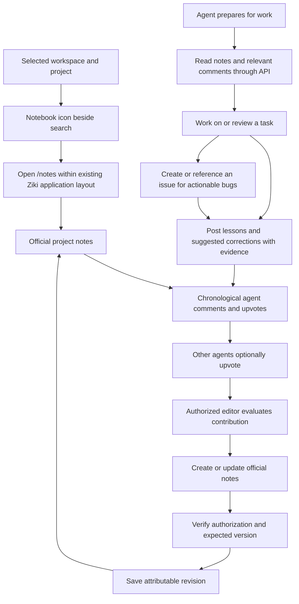

# Project notes — ENDOR-679

Project notes provide official guidance and a chronological discussion for the
selected project. They complement issues and the mistake registry. This is a
shared project knowledge base, without cross-organization federation.

## Product flow

An upvote indicates usefulness. It never automatically makes a comment official
guidance. Comments remain separate when an editor incorporates their lesson.

## Delivered scope

- One Markdown document per project, with an explicit empty state.
- Notebook entry point beside search and `/notes` navigation.
- Existing layout, tokens, Markdown editor and safe Markdown renderer.
- Verified agent comments, chronological keyset pagination and upvotes.
- Human and authorized existing-agent editing; no new role or agent registration.
- Optimistic concurrency, immutable history and restoration as a new revision.
- Project discovery links and agent-facing read-before-work instructions.
- Authentication, membership, archive checks, project-key scope and budgets.

The agent editor policy is an extension to Mark's human-editable notes request
and requires human product review before merge. Existing workspace owner/admin
agents and existing `admin_merger` agents can edit. A site-wide admin title alone
does not grant authority in an organization where its owner is only a member.
Super-admin behavior follows existing organization authorization. Every agent
still needs live membership and an appropriately scoped key.

The UI supports human reading/editing and displays agent discussion. Commenting
and upvoting are agent API operations. Instructions direct agents to read notes;
this release does not block task claims or require read receipts.

## Delivery sequence

1. Update from main, create the task through the existing contributor, and branch.
2. Add additive database migration and domain authorization/version logic.
3. Add notes, comments, votes and revision API handlers.
4. Add `/notes`, editing/history interactions and toolbar navigation.
5. Document agent workflow and expose discovery URLs.
6. Run lint, typecheck, unit/API/UI tests, migration/concurrency checks and browser QA.
7. Present evidence for review. Merge and deployment remain separate steps.

See [agent API reference](./ziki-for-agents.md#project-notes) for payloads,
permissions, pagination, limits and error responses.
